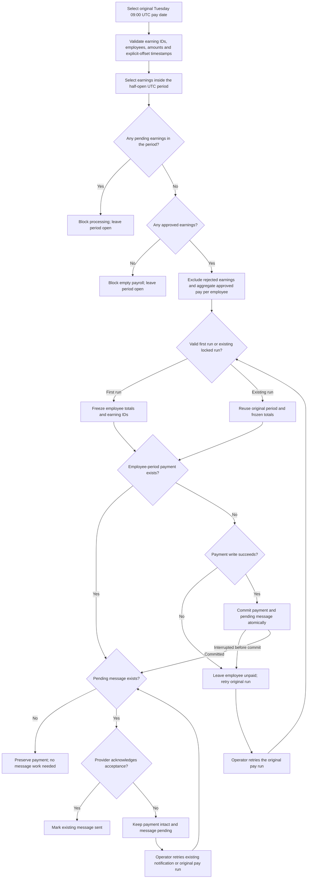

# Payroll rule and flow

**One employee receives one payment for the total approved earnings in one pay period.** Sending or recovering a notification must not create another payment or reverse the successful payment.

## Establish the period and amount

1. Payroll uses a scheduled Tuesday at 09:00 UTC. Retrying uses the original scheduled pay date. The demo runs on an explicit operator action; it has no background scheduler or enforcement of real-time execution.
2. The period starts on the previous Monday at 00:00 UTC, inclusive, and ends on the following Monday at 00:00 UTC, exclusive. The 13 October 2026 run covers [5 October 00:00 UTC, 12 October 00:00 UTC).
3. An earning belongs to the period containing its earning timestamp, not its import timestamp. Timestamps require Z or an explicit offset and are normalized to UTC. For example, 5 October 00:30 at +01:00 is 4 October 23:30 UTC and is excluded from that period.
4. Each earning has an immutable ID, employee, description, timestamp and positive amount in whole kobo. An identical reimport is harmless. Conflicting use of an ID rejects the entire import transaction. Each record is limited to ₦1,000,000; employee totals can combine multiple records.
5. Only approved earnings contribute to pay. Pending earnings in the selected period block processing until approved. Rejected earnings contribute nothing. Pending earnings in another period do not block this period.
6. The amount paid is the sum of approved earnings for each employee. This model has no deductions or tax calculation; there is no separate calculated net-pay promise.

## Process and recover

1. The first valid processing request freezes the period's employee totals and earning IDs. Empty approved payroll and pending approvals cannot create a pay run.
2. The corrected implementation checks the durable key (workspace, period start, employee). A unique database index also protects that identity. A different period can pay the same employee again.
3. The payment and pending notification work commit in one SQLite transaction. An interruption before commit leaves both absent. A payment failure creates no notification.
4. Only after commit does the service attempt notification. Failure leaves the payment intact and the notification pending.
5. Retrying payroll recovers unpaid entries and pending messages. Notification-only recovery dispatches existing message work without creating payments.
6. The simulated notification provider accepts one identity per workspace, period and employee. A lost acknowledgment can be retried without a second acceptance. This is a fixture guarantee, not a claim about a real provider or real inbox delivery.

The fault under investigation changes step 2: it treats successful notification as proof that payroll is complete. After notification failure, a payment exists but the completion marker is absent. Retrying therefore records a second payment. See the [defect report](defect-report.md).

## Decision flow

This diagram shows the corrected flow. On an existing run, frozen entries are reused. Pending approvals and an empty approved total block creation of a first run. Validation errors reject the request without importing a partial batch. A rejected earning is excluded; approved earnings must still produce a non-empty total before processing.

The retry trigger is an explicit product action in this reference, not an autonomous worker. The faulty branch instead checks the notification-dependent completion marker at the payment-exists decision. [The test execution results](../executions/README.md) shows why that distinction creates the duplicate. [The handoff instructions](directive.md#resultshandoff-appendix) explains which recovery action to choose.

## Account and administration assumptions

Employees and their masked destinations are seeded and cannot be changed through this application. Reassignment, account closure, bank-detail changes, inactive employees, permissions and admin overrides are outside scope. Payment records retain the employee name and destination captured at payment time. Earnings cannot be added to a processed period; adjustments require a later open period. Approved earnings cannot be edited or withdrawn. The schedule, currency and period policy are fixed.

Workspaces isolate examples, but they are not an authentication boundary. The server must remain local. One Node process performs synchronous SQLite operations. Eight overlapping HTTP requests test that process; they do not establish distributed-worker safety. A fresh-process test establishes graceful close/reopen recovery, not power-loss durability. The ledger records local payments and does not prove money movement through an external bank.

## User journey

Employees → review destination. Earnings → record and approve. Pay runs → choose period, review employee totals and confirm. Payments → reconcile records and retrieve receipts. Notifications → recover delivery while retaining the payment record.

The interface displays period boundaries in UTC, distinguishes recorded pay from approved pay, and signals a mismatch when duplicate records exceed the approved total. Processing confirmation can be cancelled before any ledger change. Previous receipts remain retrievable after navigation and reload. Failure preparation uses local tooling. The faulty and fixed applications are separate application folders; implementation is not selected inside the product or workspace.

Each browser tab retains its workspace and selected pay date after navigation and reload. Opening another example cannot silently substitute its payroll records into the first tab. This is navigation state, not authentication.
