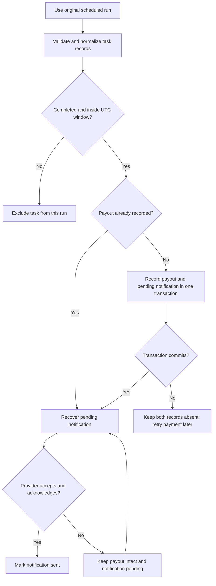

# Business rule and flow

The rule is simple: **one qualifying task earns one reward**. Notification delivery communicates the reward; it does not decide whether that reward already exists.

## Inputs and assumptions

- A run uses its scheduled Tuesday 09:00 UTC identity, rather than the wall-clock time of a retry. Scheduling is simulated by an explicit run action; no background scheduler is implemented.
- The window starts on the previous Monday at 00:00 UTC and ends the following Monday at 00:00 UTC, excluding the end. For 13 October 2026: `[2026-10-05T00:00:00Z, 2026-10-12T00:00:00Z)`.
- Completion timestamps require `Z` or an explicit offset and are normalized to UTC before comparison. Pending and cancelled records are excluded even if their supplied timestamp is inside the window.
- Each scenario is a separate program. A task ID identifies one immutable task within that program; identical imports do not add another task. Different examples can reuse fixture IDs because their ledgers are independent.
- Owner, status and completion time cannot change after import. Account closure, owner migration, late status changes, reversals and admin overrides are not implemented. These require agreed product rules before adding them.
- The amount is fixed at 10 test credits. Admin settings cannot change the amount or schedule. No exchange rates, real funds or external payment provider are involved.
- The simulated notification provider has a stable `(program, task)` acceptance identity. It can fail before acceptance or lose the acknowledgment after acceptance. This does not establish a real provider's delivery guarantees.

## Corrected flow

In the faulty flow, the completion marker is written only after notification succeeds. When delivery fails, the payout exists but the marker does not. The next settlement consults that marker and pays again. The corrected flow consults the durable payout identity and retries only pending messages.

Payment and pending notification work commit atomically in SQLite. The unique payout key provides an additional guard against a second record. The UI reads persisted state; refreshing the browser cannot reset payment identity. A fresh-process check verifies recovery after a graceful close and reopen. An injected transaction interruption verifies rollback before commit. Neither claims a power-loss or distributed-provider test.
