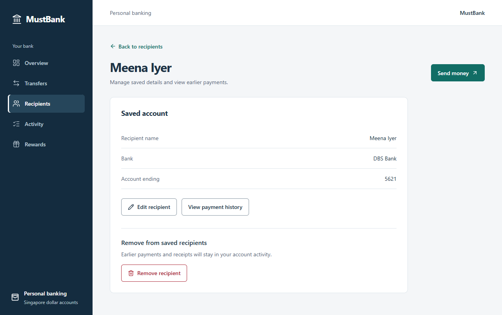
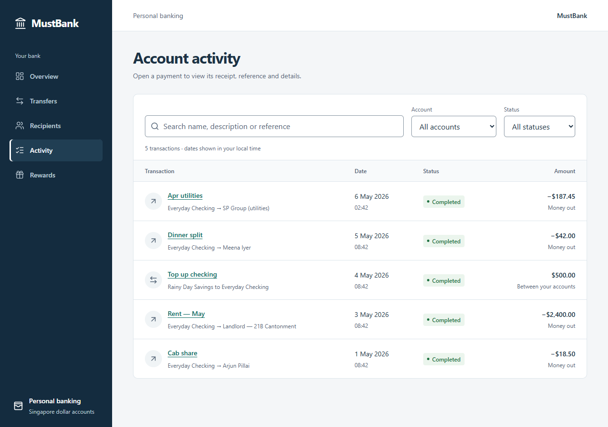
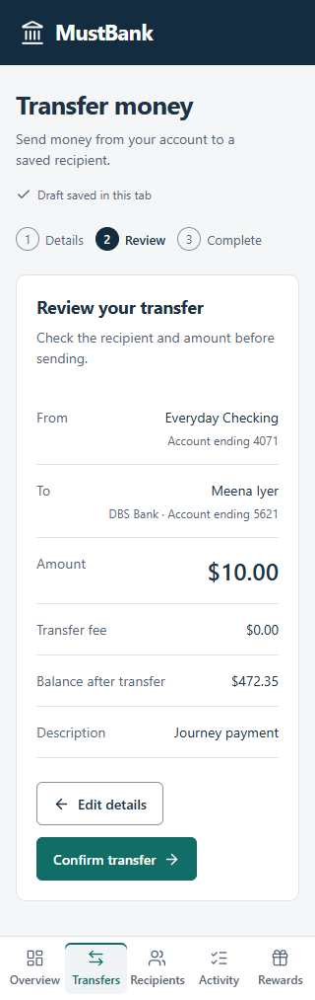

# MustBank customer journey verification

The customer journey now preserves payment intent from entry to completion, keeps receipts accessible afterwards, and separates personal banking from reward operations. The controlled settlement defect remains reproducible through local fixture tooling.

This document records the implementation against the 15 October UX audit. The target is a complete, professional journey within the local prototype's scope. A perfect usability score is not claimed without user research, assistive-technology testing and real-device evidence.

## Audit findings and corrections

| Finding | Resulting behavior | Evidence |
|---|---|---|
| Payment destination selected implicitly | A generic transfer starts at Choose a recipient. An explicit Send money action can select its payee. | TC35 |
| Recipient detour loses entered work | Adding or cancelling a recipient returns to the account, amount and description saved in that tab. Reload preserves the draft; discarding requires confirmation. | TC36–TC37 |
| Receipt cannot be retrieved later | Every payment opens a permanent local details URL from activity, with timestamp, reference, recipient snapshot, balance after payment, copy and download. | TC38 and TC45 |
| Saved recipients cannot be corrected or removed | Edits require review; removal requires confirmation and keeps earlier receipts. A changed destination invalidates an open recipient choice without discarding the amount or description. | TC39–TC40 and TC46 |
| Account activity obscures money direction | Internal transfers show money out and a negative amount for the source account; money in and a positive amount for the destination. Returning from a receipt retains the activity filter. | TC41 |
| Reward meaning and timing are unclear | Credits are explicitly separate from SGD and have no cash conversion/redemption. Each activity has a scheduled payment date; overdue and future payments are distinguished. Historical records use Settlement period. | TC42 |
| Mobile rewards bury the useful information | Compact balances and payment status precede activities; payout history has a compact empty state. Bottom navigation reserves space beneath controls. | TC43–TC44 |

## Verified flow and screenshots

1. **Overview — clear entry.** Deposit balances and credit-card debt remain separate. Account activity and the transfer entry are easy to find.

   

2. **Transfer details — deliberate and resumable.** No generic payee default. A draft is saved in the tab; changing or removing its destination asks for a new choice while retaining the other inputs.

   

3. **Recipient creation — returns to the task.** Account details are reviewed before saving. Transfer entry from the recipient detour resumes the preserved draft with the new payee selected. Saved recipients have management and payment-history paths.

   

4. **Review and receipt — intent becomes a lasting record.** Review shows the recipient, fee, description and resulting balance. Confirmation creates one local payment reference. Later edits and removal cannot rewrite its recipient snapshot; reloading or browser history does not resubmit the transfer.

   

   

5. **Activity — navigable evidence.** Payment titles open the receipt. Account-specific debit/credit signs communicate direction, and returning keeps the filter context.

   

6. **Rewards and operations — clear states for each actor.** Personal rewards show the customer's points, payment dates, delayed states and statement. Operations still runs settlement and recovers confirmations. The unchanged core regression demonstrates 20 credits under faulty replay and 10 under the correction.

   

   

7. **Mobile — priorities and controls remain accessible.** The 320px rewards view exposes its first activity title above the fixed navigation. The transfer confirmation control scrolls clear of the navigation. The operations recovery is checked at 380px.

   

   

## Coverage and limits

The implementation uses React, TypeScript, native form controls and dialogs, shared CSS tokens and Lucide icons. No separate repository design standard was found. Accessibility, layout, writing, typography, color and UI principles informed the implementation.

Native confirmation dialogs support Escape and focus restoration. Validation binds errors to fields and focuses the first invalid input. Transfer review/edit/confirmation is checked with keyboard controls. Route headings receive focus, status is communicated by text as well as color, inputs remain 16px, and bottom navigation has minimum touch targets and safe-area padding.

The recorded checks exercise these specific journeys; they do not establish complete WCAG conformance or a measured 10/10 usability result. Screen-reader behavior, native zoom, RTL, real mobile devices and other browsers remain unverified. Chromium captures are local evidence; in-app browser automation remains unavailable on this host.

Account data and receipts remain browser-local. New recipient details use synthetic account numbers and are masked in lists/receipts. Drafts live in session storage for the current tab. This is not a production persistence, authorization or distributed transaction guarantee. Reward payouts keep their independent SQLite ledger and existing assessment rules.

See [case inputs/results](test-cases.md), [recorded source hashes](evidence/summary.json), and the bounded [release decision](release-readiness.md).
