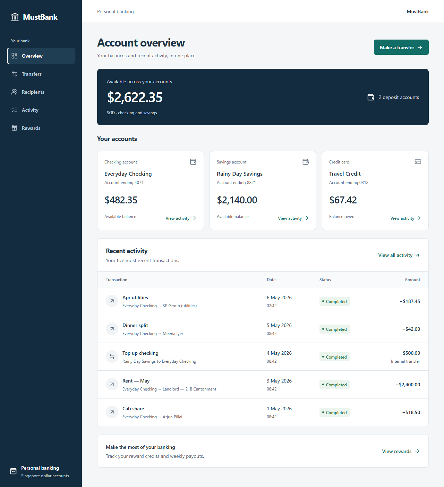
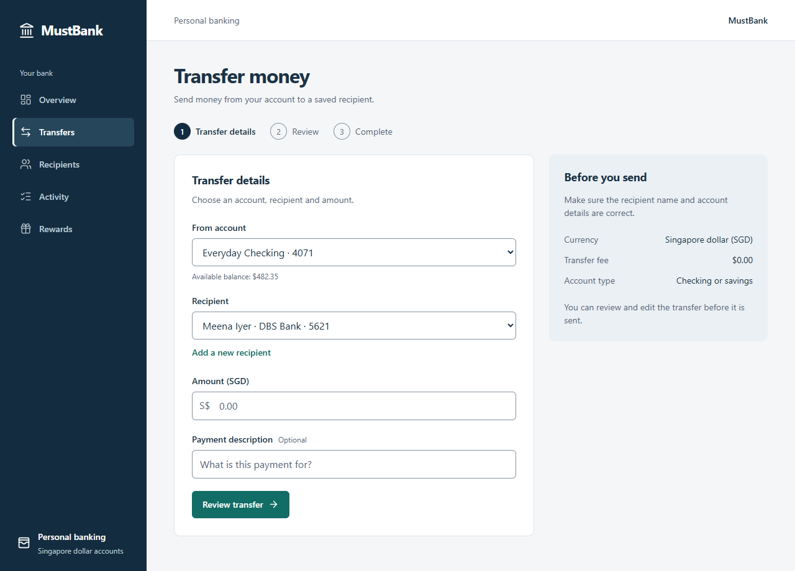
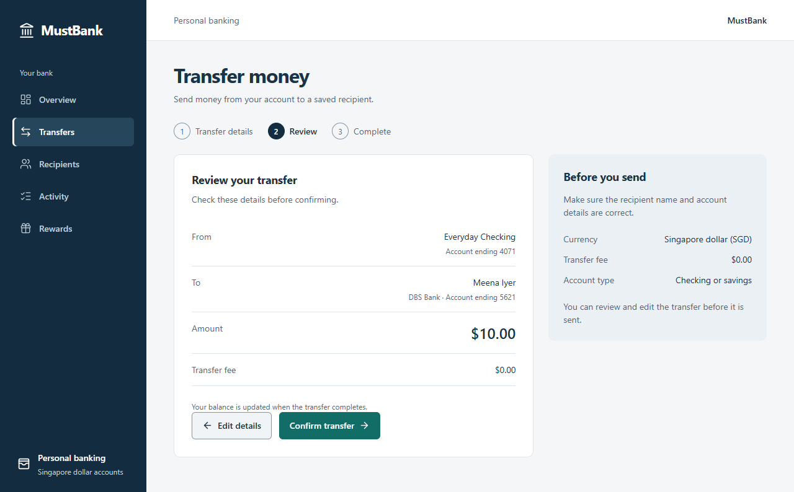
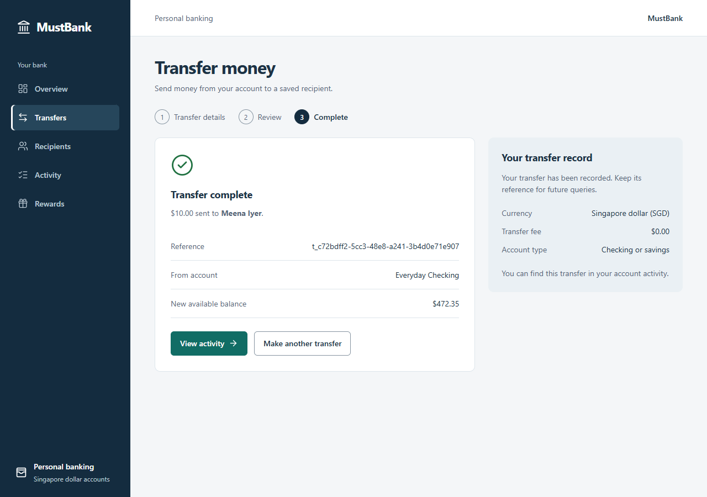
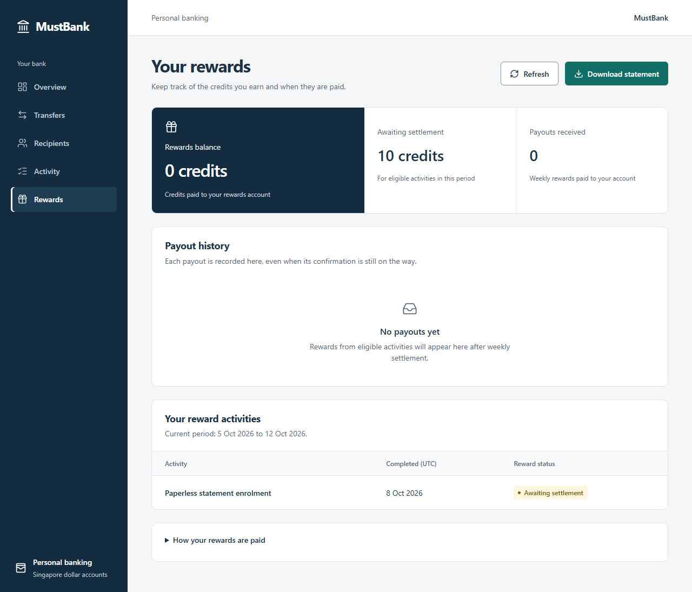
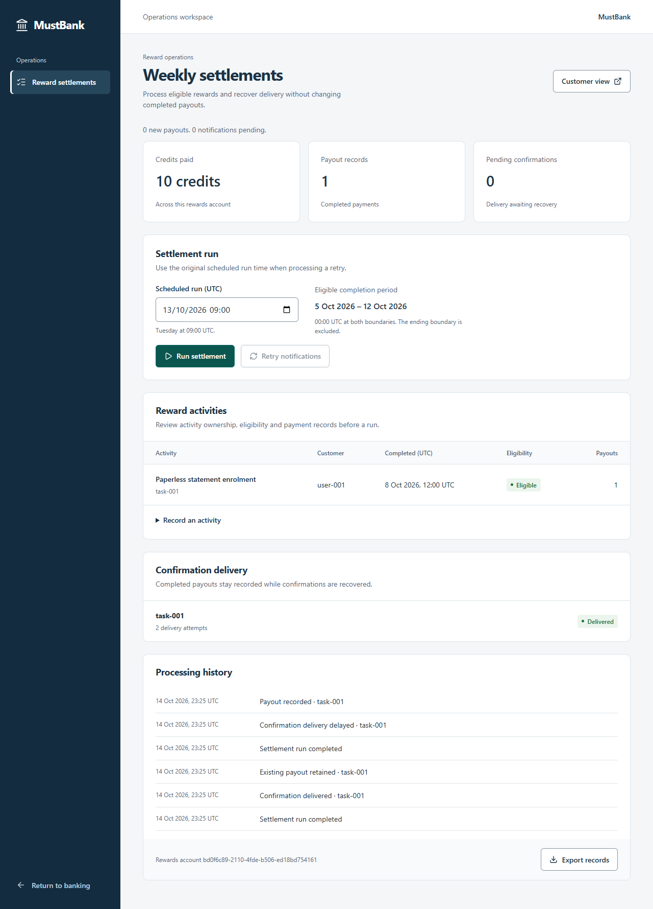
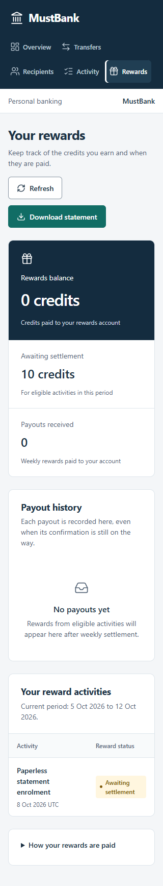

# MustBank interface review

**Ready with known limitations for the local prototype.** The customer journey now reads as personal banking. Customers review balances, send money, manage recipients, inspect activity and track their own rewards. Weekly settlement and notification recovery belong to the operations workspace. Failure preparation stays in local tooling.

This review covers the rendered customer pages, transfer review and receipt, and the operations recovery flow. The implementation uses React, TypeScript, native controls, shared CSS tokens and Lucide icons. No separate repository design standard or component library was found. The review applied accessibility, layout, writing, typography, color and UI principles in that order.

## Flow and accepted screenshots

1. **Account overview — clear entry point.** Deposit balances are combined in the available total; credit-card debt is labeled separately. Make a transfer is the primary action. Account activity and rewards are reachable from the overview and navigation.

   

2. **Transfer details and review — explicit decision before payment.** Account, recipient and amount have visible labels. Invalid or unaffordable amounts show a corrective message. Review displays the recipient, amount and fee, with an Edit details action. TC25 and TC29 confirm that review does not commit a transfer.

   

   

3. **Transfer receipt — clear completion and next action.** The receipt identifies the recipient, reference and remaining balance. View activity leads to the transaction record. TC25 verifies one committed transfer and the expected balance.

   

4. **Personal rewards — payment state separated from eligibility.** Rewards balance represents paid credits; Awaiting settlement represents qualifying activities still to be paid. Payout history communicates payment and confirmation states separately. TC32 verifies that the personal view contains only fixture customer `user-001`; TC33 checks the personal CSV export.

   

5. **Operations recovery — ordinary business actions.** Run settlement and Retry notifications expose the operational task without processing-version or failure-injection switches. The corrected recovery leaves one payout and recovers its message. TC10, TC21 and TC22 cover settlement, multiple owners and persisted recovery.

   

6. **Narrow-screen banking — readable within the checked widths.** All five customer pages were checked at 320px; the operations recovery was checked at 380px. Navigation wraps, account metrics stack and essential row information remains visible. These checks found no whole-page horizontal overflow. TC24 uses keyboard activation for settlement and notification recovery.

   

Recipient creation, search and transfer preselection also pass TC30. Activity filters and Clear filters recover an empty result in TC31. Their behavior is covered by the automated checks; these flows do not have a separate screenshot sequence in this report.

## Findings resolved

The initial [rewards screen](evidence/ui-before-rewards.png) mixed customer banking, assessment explanation and failure setup. The following changes address the main causes, ordered by user impact. These are completed fixes, not open defects.

| Impact | Cause and evidence | Resolution |
|---|---|---|
| High | Mixed actors and assessment copy made the customer's next action unclear; baseline screenshot and `src/App.tsx:17` / `src/pages/Rewards.tsx:16` | Separate personal banking from operations; remove assessment and fixture controls from customer copy. TC26 checks all five pages. |
| High | A money transfer needs an explicit review before commitment; `src/pages/Transfer.tsx:20` and `src/pages/Transfer.tsx:50` | Details → review → confirmation → receipt, with editable details and corrective validation. TC25, TC28 and TC29 verify the effects. |
| Medium | A paid-credit total labeled as earned could be confused with an eligible activity awaiting payment; `src/pages/Rewards.tsx:18` | Label the total Rewards balance and describe it as paid credits; keep Awaiting settlement separate. |
| Medium | Garbled separators and loading text impaired comprehension; transfer/rewards/operations source and the observed form snapshot | Correct UTF-8 text and inspect the rendered form again. |
| Medium | Dense desktop information needed a narrow-screen reading order; `src/styles.css:213` | Stack sections and retain essential dates and status in the row content when supplementary columns collapse. TC24 and TC34 check overflow. |

## Accessibility and evidence limits

The inspected implementation uses native labeled inputs, visible focus styles, a skip link, status text alongside color, inline corrective errors, semantic table headings, and focus on the transfer stage heading. Primary buttons and form controls have a minimum height of 44px. No motion-dependent state or autoplay was introduced.

Computed contrast for the declared solid color pairs is 6.18:1 for the primary button, 13.17:1 for body text, 5.89:1 for secondary text, and at least 5.38:1 for checked status labels. These measurements and the rendered inspection support the selected colors; they do not establish full accessibility conformance.

The complete `npm run verify` evidence records 33 corrected Playwright cases and one fresh-process check. The same TC10 assertion fails against controlled faulty processing at 20 credits and passes against the correction at 10. Screenshots in this report were captured and inspected during this implementation review; the baseline is explicitly identified as the before state.

In-app browser automation could not initialize on this host, so the existing Playwright Chromium workflow supplied the captures. Complete keyboard traversal, screen-reader behavior, native zoom, RTL, Firefox, WebKit and real mobile devices remain unverified. The customer projection is a fixture view, not production authorization. See the [release decision](release-readiness.md) for functional and deployment limits.
